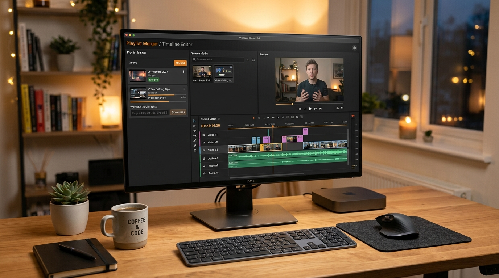

# YouTube Playlist Merger & Timeline Studio

A desktop utility for downloading YouTube playlists, standardizing video clips to a uniform resolution (1080p Full HD by default), and merging them into a single continuous video. Supports extended duration rendering (such as 10-hour loops) and includes a browser-based multi-track timeline editor.



---

## Features

- **Standardized Video Normalization**: Scales and pads input clips to a uniform resolution (1920x1080 by default, with support for 720p, 4K, and 480p). Prevents aspect ratio distortion and video freezes when stitching mixed-source clips.
- **Unified Audio Resampling**: Re-samples all audio tracks to 48kHz stereo AAC using `aresample=async=1000` to prevent audio/video drift across multi-hour outputs.
- **Hardware-Accelerated Encoding**: Automatically probes and selects available hardware encoders (`h264_nvenc` for Nvidia, `h264_qsv` for Intel, `h264_amf` for AMD, or `h264_mf` on Windows) before falling back to CPU `libx264`.
- **Flexible Duration Modes**:
  - *Natural Duration*: Merges all downloaded playlist videos in order from start to finish.
  - *Target Duration (Loop Mode)*: Loops and extends shorter sequences (e.g., a 20-minute track) to reach target lengths such as 1 hour, 8 hours, or 10 hours.
- **Intro Trimming Control**: Intros remain 100% intact by default. An optional trim slider allows skipping repetitious introductory segments (1 to 120 seconds) when desired.
- **Visual Timeline Editor Studio**: An integrated local web studio running on `http://localhost:7860` for multi-track timeline arrangement, clip trimming, speed changes, and volume adjustments.
- **Playlist Extraction**: Automatically cleans watch URLs containing `&list=` parameters to download entire playlists rather than single videos.

---

## Prerequisites

- **Python**: 3.8 or newer.
- **FFmpeg**: Installed and available in your system `PATH`, or located in `C:\ffmpeg\bin`.
- **yt-dlp**: Installed via pip (or using the included batch file).

---

## Installation

Clone the repository:

```bash
git clone https://github.com/Rajtech69/yt-playlist-merger.git
cd yt-playlist-merger
```

Install dependencies:

```bash
pip install -r requirements.txt
```

On Windows, you can also run `install_deps.bat`.

---

## Usage

### 1. Desktop GUI (Tkinter)

Run the desktop application:

```bash
python main.py
```

Or double-click `run.bat` on Windows.

1. Paste the YouTube playlist URL into the input field.
2. Select an output directory and filename.
3. Choose your desired target resolution (1080p, 720p, 4K, or 480p).
4. Select the duration mode (Natural Playlist Length or Specific Duration loop).
5. Click "Start 1080p Merge & Render".

### 2. Visual Timeline Studio (Web Interface)

Run the local web studio backend:

```bash
python editor_backend.py
```

Or double-click `run_timeline_editor.bat` on Windows.

Once running:
- Open your browser to `http://localhost:7860`.
- Paste playlist links to import assets directly into the media bin.
- Drag clips onto the timeline, trim handles, set volume and playback speeds, and click export.

---

## Technical Details

### FFmpeg Pipeline

The processing pipeline runs in two distinct stages:

1. **Clip Standardization**: Each source clip is normalized individually to match target parameters:
   - Video filter: `scale=1920:1080:force_original_aspect_ratio=decrease,pad=1920:1080:(ow-iw)/2:(oh-ih)/2:color=black,setsar=1,fps=30,format=yuv420p`
   - Audio filter: `aresample=async=1000,asetpts=PTS-STARTPTS`
   - Container settings: `-movflags +faststart` to place the moov atom at the beginning of the file for instant playback.

2. **Stream-Copy Concatenation**: Once clips share identical codecs, sample rates, and pixel formats, the final assembly uses FFmpeg's concat demuxer (`-c copy`) to merge segments without generational quality loss or re-encoding overhead.

---

## Project Structure

```
yt-playlist-merger/
├── assets/
│   └── preview.jpg           # Application preview image
├── downloader.py             # yt-dlp playlist extraction and download hooks
├── editor_backend.py         # Local HTTP server and timeline rendering backend
├── editor_ui.html            # Web-based multi-track timeline user interface
├── install_deps.bat          # Dependency installer script for Windows
├── main.py                   # Tkinter desktop application entry point
├── requirements.txt          # Python requirements list
├── run.bat                   # Desktop app launcher
├── run_timeline_editor.bat   # Timeline Studio launcher
├── video_processor.py        # FFmpeg video normalization and concat pipeline
├── .env.example              # Optional environment variables template
├── .gitattributes           # Git line-ending configuration
├── .gitignore                # Git exclusions (videos, outputs, caches)
├── LICENSE                   # MIT License
├── README.md                 # Project documentation
└── SECURITY.md               # Security policy
```

---

## Troubleshooting

- **Only one video downloads**: The URL parser automatically converts watch URLs with `list=` parameters to clean playlist URLs. Ensure your playlist is set to Unlisted or Public on YouTube.
- **FFmpeg not found**: Ensure `ffmpeg.exe` and `ffprobe.exe` are in your system `PATH` or placed in `C:\ffmpeg\bin`.
- **Audio desync on long renders**: Built-in 48kHz audio resampling (`aresample=async=1000`) prevents clock drift across multi-hour videos.
- **Disk space requirements**: 10-hour 1080p files typically require between 15 GB and 25 GB of free drive space.

---

## License

This project is licensed under the [MIT License](LICENSE).
